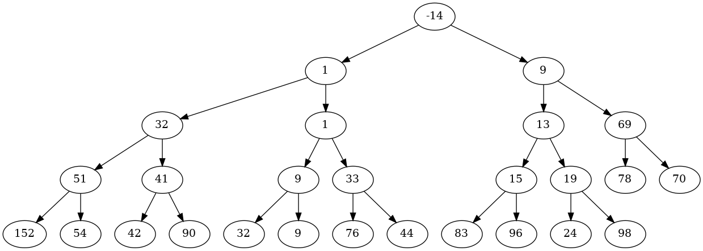
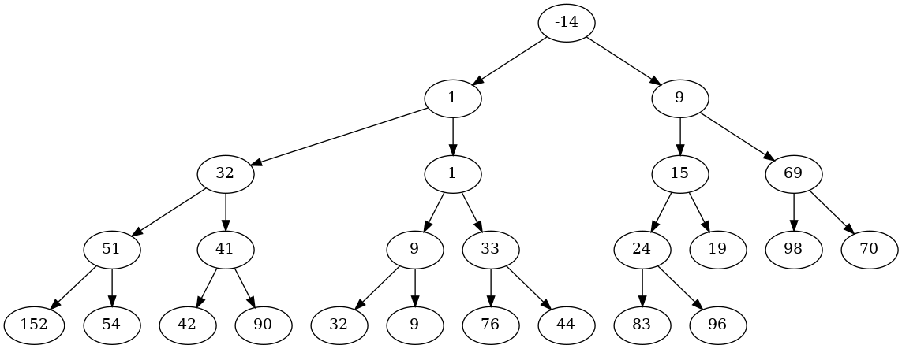

# Data Structures Assignment and Verification Tools

- **Unit**: Data Structures and Algorithms (`COMP1002` / `DSA1002`) — Assignment 2
- **Study Period**: 2023 Trimester 1A
- **Degree Programme**: Bachelor of Information Technology — Awarded with Distinction by Curtin University
- **Overall Unit Mark**: 89 (High Distinction)

<table>
  <thead>
    <tr>
      <th colspan="6">Curtin University &bull; Bachelor of Information Technology</th>
    </tr>
  </thead>
  <tbody>
    <tr align="center" style="font-weight: bold; background-color: #f6f8fa;">
      <td>2022 T3A</td>
      <td>2023 T1A</td>
      <td>2023 T2A</td>
      <td>2023 T3A</td>
      <td>2024 T1A</td>
      <td>2024 T2A</td>
    </tr>
    <tr>
      <td valign="top">
        <abbr title="Fundamentals of Programming (92 HD)"><b>COMP1005</b></abbr><br>
        &bull; <a href="https://github.com/honneground/COMP1005-Vampire-Ecosystem-Simulation">Vampire Eco</a><br>        &bull; <a href="https://github.com/honneground/COMP1005-Vehicle-Emissions-Analyzer">Emissions</a><br>      </td>
      <td valign="top" style="background-color: #f1f8ff; border: 2px solid #0969da;">
        <abbr title="Data Structures and Algorithms (89 HD)"><b>COMP1002</b></abbr><br>
        &bull; <a href="https://github.com/honneground/COMP1002-StudyHelp-Academic-Network">StudyHelp</a><br>        &bull; <b>&#128073; Visualizer</b><br>        <abbr title="Unix and C Programming (90 HD)"><b>COMP1000</b></abbr><br>
        &bull; <a href="https://github.com/honneground/COMP1000-Terminal-Maze-Survival-Game">Maze Survival</a><br>        &bull; <a href="https://github.com/honneground/COMP1000-Terminal-Maze-Darkness-Game">Maze Darkness</a><br>        &bull; <a href="https://github.com/honneground/COMP1000-Bookstore-Transaction-Simulator">Bookstore</a><br>        <abbr title="Introduction to Software Engineering (95 HD)"><b>ISAD1000</b></abbr><br>
        &bull; <a href="https://github.com/honneground/ISAD1000-Software-Testing-and-Pocket-Beast-Game">Pocket Beast</a><br>      </td>
      <td valign="top">
        <abbr title="Unix Systems Programming (88 HD)"><b>COMP2002</b></abbr><br>
        &bull; <a href="https://github.com/honneground/COMP2002-Parallel-Directory-File-Calculator">Dir Calculator</a><br>        <abbr title="Operating Systems (80 HD)"><b>COMP2006</b></abbr><br>
        &bull; <a href="https://github.com/honneground/COMP2006-Customer-Queue-Concurrency-Simulation">Queue Sim</a><br>      </td>
      <td valign="top">
        <abbr title="Database Systems (80 HD)"><b>ISYS2014</b></abbr><br>
        &bull; <a href="https://github.com/honneground/ISYS2014-Relational-Database-Management-System">FootyStats DB</a><br>        <abbr title="Quantitative Techniques for Business (87 HD)"><b>ECOM2001</b></abbr><br>
        &bull; <a href="https://github.com/honneground/ECOM2001-Econometric-Statistical-Analysis-R">Econometric R</a><br>      </td>
      <td valign="top">
        <abbr title="Financial Decision Making (93 HD)"><b>ACCT1002</b></abbr><br>
        &bull; <a href="https://github.com/honneground/ACCT1002-Financial-Decision-Calculators">Finance Tools</a><br>        <abbr title="Human Computer Interface (71 D)"><b>ICTE3002</b></abbr><br>
        &bull; <a href="https://github.com/honneground/ICTE3002-Lumen-Interaction-Design">Lumen UI</a><br>        <abbr title="Engineering Management and Professional Practice (79 D)"><b>MGMT3000</b></abbr><br>
        &bull; <a href="https://github.com/honneground/MGMT3000-Phone-Router-Repurposing-Design">Phone Router</a><br>      </td>
      <td valign="top">
        <abbr title="Capstone Computing Project 1 (94 HD)"><b>ISAD3000</b></abbr><br>
        &bull; <a href="https://github.com/honneground/ISAD3000-CurtinSG-App-Design">CurtinSG UI</a><br>        <abbr title="Capstone Computing Project 2 (95 HD)"><b>ISAD3001</b></abbr><br>
        &bull; <a href="https://github.com/honneground/ISAD3001-CurtinSG-Student-App">CurtinSG App</a><br>        <abbr title="Advanced Computer Communications (88 HD)"><b>CNCO3002</b></abbr><br>
        &bull; <a href="https://github.com/honneground/CNCO3002-Multi-Service-Socket-Server">Socket Server</a><br>      </td>
    </tr>
  </tbody>
</table>


## Assignment context

This assessment combined executable answers with written reasoning and step-by-step diagrams. Its topics included data-structure selection, sorting and recursion, expression term counting with a stack, a bounded print queue, tree construction, graph traversal, heap insertion/deletion and hash-table probing.

Some questions required manual diagrams or worked steps. I developed companion programs to verify those steps and generate figures, alongside the four submitted scripts.

## Repository contents

| Directory | Contents |
|---|---|
| `submission/` | The four submitted scripts and the author's hash-workings CSV |
| `visualization/` | Tree/heap drawing, graph-traversal traces, heap-deletion and hashing helpers used to inspect worked examples |
| `practicals/graph/` | Custom graph/linked-list/stack/queue implementation and its original practical harness |
| `practicals/heap/` | The coherent bounded-heap practical implementation, file I/O, sample records and harness |
| `assets/` | Selected insertion and deletion diagrams demonstrating the visual output |

### Submitted scripts

- `submission/2D.py`: converts an iterative factorial-based calculation into recursion with a wrapper, exception handling and printed example cases.
- `submission/3A.py`: uses a NumPy-backed stack to compare the number of terms on the two sides of an equality.
- `submission/3B.py`: implements a capacity-100 print queue on a double-ended singly linked list and demonstrates attempts to enqueue and dequeue 102 jobs.
- `submission/5D.py`: stores a binary tree in an array and displays levels using the child-index rules.
- `submission/hash.csv`: worked hash-table insertion/probing output supporting the written analysis.

### Verification and visualization tools

`visualization/bst.py` and `rbt.py` use **bintrees** for the underlying tree algorithms and **Graphviz** to export the evolving structures. The scripts automate diagram generation and inspection of tree changes.

`visualization/heap.py` wraps Python's **heapq** for step-by-step min-heap drawings. `heap_way_tree.py` instead draws the array values in binary-tree layout. `twofor.py` contains a separate 2-3-4 tree insertion/splitting implementation and drawing functions. `graph.py` prints DFS/BFS frontier and path states for its included example graph.

`visualization/heap_deletion/DSAHeap.py` is the author's custom heap variant with insertion, arbitrary-value deletion and intermediate Graphviz drawings. It negates priorities in the included example to demonstrate min-heap behavior using its maximum-priority implementation. `visualization/hashing/hashtable.py` prints hash calculations and appends insertion traces to CSV.

The practical heap implementation includes its own entry class, file I/O and harness in `practicals/heap/`.

## Selected output





## Run the submitted examples

Use Python 3 and NumPy. From this project directory:

```bash
python -m pip install numpy
python submission/2D.py
python submission/3A.py
python submission/3B.py
python submission/5D.py
```

The examples print their own result or demonstration sequence.

## Run the tools

Drawing tools additionally use the Python `graphviz` package and a Graphviz installation with `dot` available on PATH. The BST/RBT tools also import `bintrees`; the graph practical's plotting helper imports `networkx` and `matplotlib`.

```bash
python -m pip install graphviz bintrees networkx matplotlib
cd visualization
python heap.py
python bst.py
python rbt.py
python heap_way_tree.py
python graph.py
cd heap_deletion
python DSAHeap.py
```

The drawing scripts write output to the current working directory. The 2-3-4 tree's drawing helper clears PNG files there before producing a new sequence, so use a separate output directory when calling `twofor.draw(...)`; the selected repository illustrations are in `assets/`.

For the original practical demonstrations, run from each directory so relative input filenames resolve:

```bash
cd practicals/graph
python testHarness.py
```

```bash
cd practicals/heap
python testHarness.py
```

The heap harness pauses for Enter and writes `outfile.csv`. The graph harness uses the included `prac6_1.al` and `prac6_2.al` adjacency-list inputs.

---

## Portfolio note

This Git repository was created retrospectively from the original project code, with assistance from OpenAI Codex and Antigravity in curating the repository and writing this README for publication. The initial commit timestamp is backdated to the original coursework submission date, followed by the final release commit.


